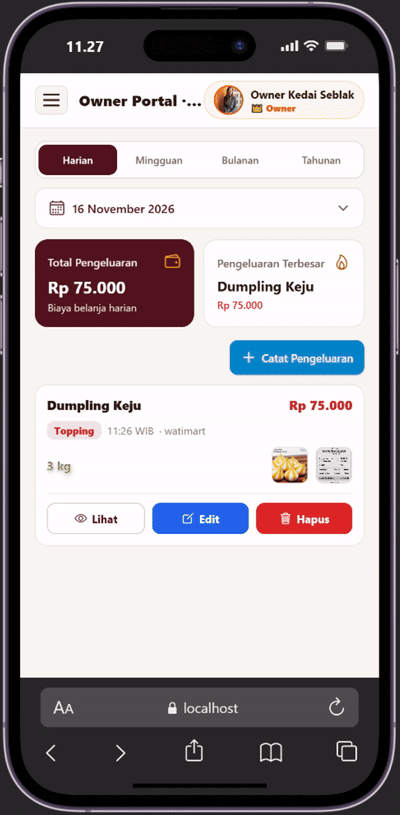
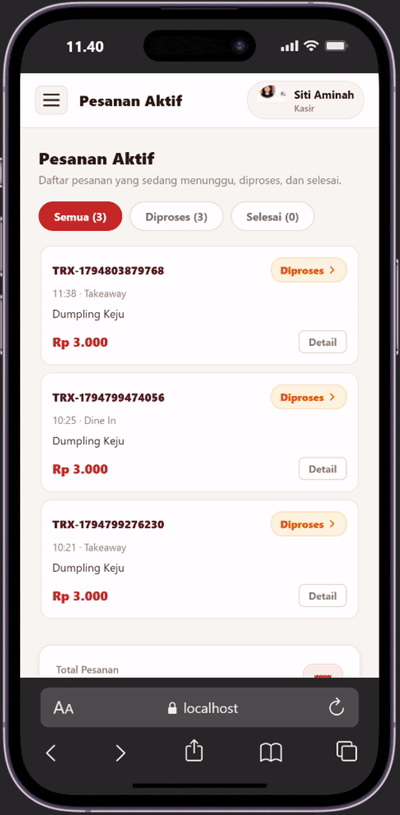

# Laporan Praktikum Pertemuan 9 — Pemrograman Mobile I
## Media Penyimpanan: CRUD dengan Supabase (Database + Cloud Storage)
### Studi Kasus: Aplikasi POS dan Manajemen Kedai Seblak Prasmanan

---

### Identitas Proyek & Praktikum

- **Mata Kuliah:** Pemrograman Mobile 
- **Pertemuan:** 9 (Media Penyimpanan)
- **Dosen Pengampu:** Mohamad Firdaus, M.Kom
- **Tanggal Praktikum:** November 2026
- **Kelas / Kelompok:** Kelas 5B / Kelompok 3
- **Repository:** https://github.com/Shinta-Agustina/Seblak-Project-Kelompok3
- **Pembagian Tugas Anggota Kelompok:**
  1. **Shinta Agustina:** Menu Kasir — Tampilan Menu pada Halaman Kasir (`menu_topping`) & Manajemen Kasir — CRUD Data Kasir (`kasir`)
  2. **Maya Trisnawati:** Transaksi dan Riwayat — Penyimpanan Transaksi Kasir, Riwayat Transaksi, Perubahan Status Pesanan, & Laporan Penjualan
  3. **Dewi Ikrimah:** Dashboard dan Stok — Dashboard Owner, Tampilan Penjualan, Stok Bahan Baku, Penambahan Stok, & Riwayat Stok
  4. **Faija Kulla Azmina:** Pengeluaran dan Laporan Keuangan — CRUD Pengeluaran dengan Foto Item & Foto Struk (Cloud Storage), Laporan Keuangan Owner, & Integrasi Pengeluaran dengan Terima Stok

### Uji 1: Catat Pengeluaran ###

### Uji 2: Read dan Update Pengeluaran ###

### Uji 3: Delete Pengeluaran ###

### Uji 4: Update Stok Bahan ###

### Uji 5: Create Transaksi Pembelian ###

### Uji 6: Read Pesanan Aktif ###

### Uji 7: Read Riwayat Transaksi ###

### Uji 8: Create Kasir ###

### Uji 9: Update Kasir ###

### Uji 10: Delete Kasir ###

### Uji 11: Read Laporan Keuangan ###