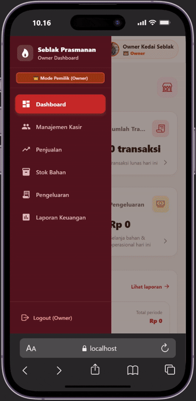
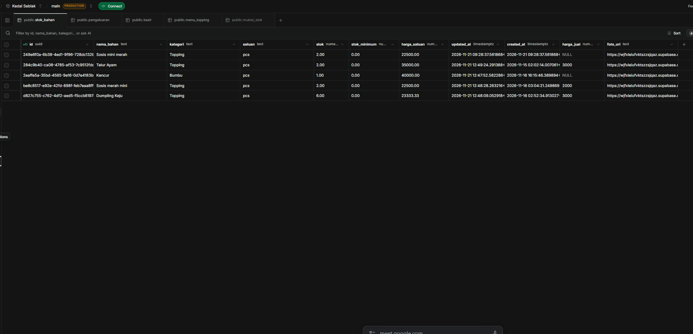
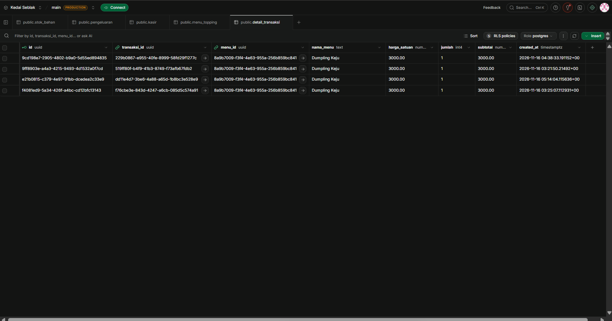
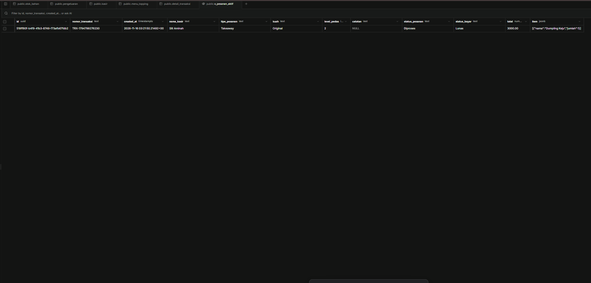
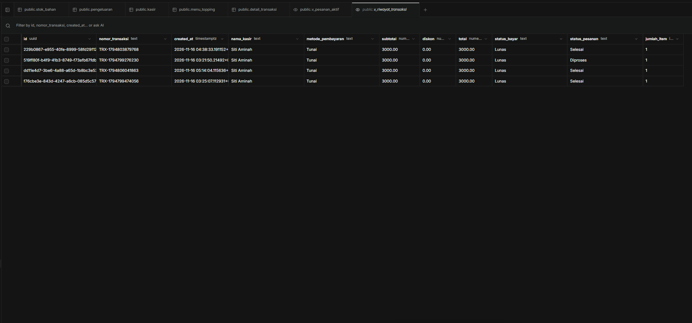
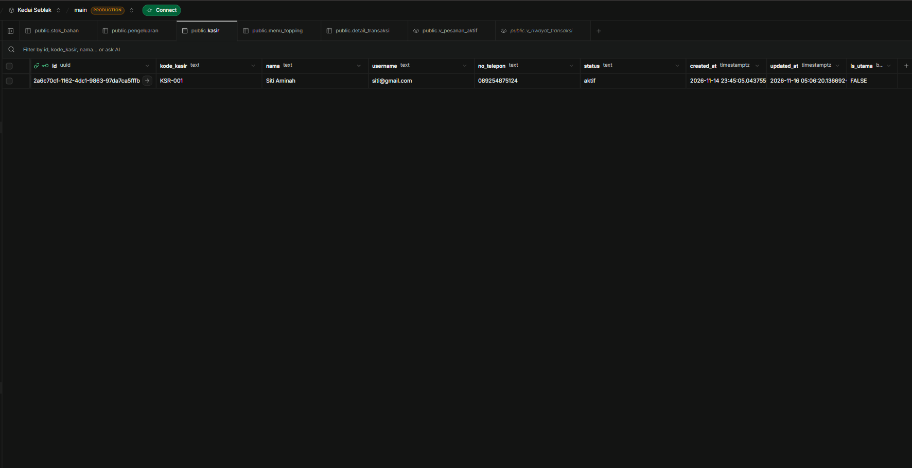

# Laporan Praktikum Pertemuan 9 — Pemrograman Mobile I
## Media Penyimpanan: CRUD dengan Supabase (Database + Cloud Storage)
### Studi Kasus: Aplikasi POS dan Manajemen Kedai Seblak Prasmanan

---

### Identitas Proyek & Praktikum

- **Mata Kuliah:** Pemrograman Mobile 
- **Pertemuan:** 9 (Media Penyimpanan)
- **Dosen Pengampu:** Mohamad Firdaus, M.Kom
- **Tanggal Praktikum:** November 2026
- **Kelas / Kelompok:** Kelas 5B / Kelompok 3
- **Repository:** https://github.com/Shinta-Agustina/Seblak-Project-Kelompok3
- **Pembagian Tugas Anggota Kelompok:**
  1. **Shinta Agustina:** Menu Kasir — Tampilan Menu pada Halaman Kasir (`menu_topping`) & Manajemen Kasir — CRUD Data Kasir (`kasir`)
  2. **Maya Trisnawati:** Transaksi dan Riwayat — Penyimpanan Transaksi Kasir, Riwayat Transaksi, Perubahan Status Pesanan, & Laporan Penjualan
  3. **Dewi Ikrimah:** Dashboard dan Stok — Dashboard Owner, Tampilan Penjualan, Stok Bahan Baku, Penambahan Stok, & Riwayat Stok
  4. **Faija Kulla Azmina:** Pengeluaran dan Laporan Keuangan — CRUD Pengeluaran dengan Foto Item & Foto Struk (Cloud Storage), Laporan Keuangan Owner, & Integrasi Pengeluaran dengan Terima Stok

## 1: Pengluaran ##


### Uji 1: Catat Pengeluaran ###


### Uji 2: Read dan Update Pengeluaran ###


### Uji 3: Delete Pengeluaran ###


## 2: Stok bahan ##



### Uji 4: Update Stok Bahan ###


## 3: Transaksi Pembelian ##



### Uji 5: Create Transaksi Pembelian ###


## 4: Pesanan Aktif ##



### Uji 6: Read Pesanan Aktif ###


## 5: Riwayat Transaksi ##



### Uji 7: Read Riwayat Transaksi ###


## 6: Kasir ##



### Uji 8: Create Kasir ###


### Uji 9: Update Kasir ###


### Uji 10: Delete Kasir ###


### 2.5 Tabel `pengeluaran` (Modul Pengeluaran dan Laporan Keuangan — Faija)
```sql
create table public.pengeluaran (
  id uuid primary key default gen_random_uuid(),
  tanggal date not null default current_date,
  nama_pengeluaran text not null,
  kategori text not null,
  jumlah numeric(12,2) not null default 1 check (jumlah > 0),
  harga_satuan numeric(12,2) not null check (harga_satuan >= 0),
  total numeric(12,2) generated always as (jumlah * harga_satuan) stored,
  supplier text,
  catatan text,
  -- [SESUAIKAN] nama kolom foto sesuai tabel di Supabase:
  foto_item text,
  foto_struk text,
  dibuat_oleh uuid references public.profiles(id) on delete set null,
  created_at timestamptz not null default now(),
  updated_at timestamptz not null default now()
);

alter table public.pengeluaran enable row level security;
create policy pengeluaran_owner_all on public.pengeluaran for all to authenticated
  using (public.is_owner()) with check (public.is_owner());
```

### 2.6 Storage Bucket `pengeluaran` (Faija)
- Bucket **publik** bernama `pengeluaran` dengan batas ukuran file 5 MB dan tipe file `image/jpeg`, `image/png`, `image/webp`.
- Struktur folder: `foto_item/` untuk foto barang yang dibeli dan `foto_struk/` untuk foto struk belanja.
- Terdapat 4 *policy* pada bucket untuk mengatur akses unggah, baca, ubah, dan hapus file.

---

## 3. Implementasi Kode Program Berdasarkan Pembagian Tugas

### 3.1 Klien Supabase Terpusat & Autentikasi (Tim)
- **`src/lib/supabase.js`**: Menginisialisasi klien Supabase dengan `createClient` yang digunakan bersama oleh seluruh *service* di `src/services/`.
- **`src/services/Authservice.js`**: `signIn`, `signOut`, dan `getCurrentSession` memakai Supabase Auth. Username diubah menjadi email dengan domain `kedaiseblak.com`, dan layar yang tampil disesuaikan dengan peran (Owner atau Kasir).

### 3.2 Modul 1: Dashboard Owner — *Dewi Ikrimah*
- **`src/screens/owner/DashboardOwner.js`**: Integrasi Supabase untuk mengambil data transaksi dari tabel `transaksi`, data stok bahan baku dari tabel `stok_bahan`, dan data pengeluaran dari tabel `pengeluaran`, kemudian menampilkan ringkasan informasi pada halaman Dashboard Owner.
- **Komponen Dashboard Owner**: Menampilkan ringkasan informasi berdasarkan data aktual dari database Supabase serta memperbarui tampilan setelah data berhasil dimuat.

### 3.3 Modul 2: Manajemen Penjualan — *Dewi Ikrimah*
- **Komponen Tab Penjualan** (`src/components/owner/tabs/TabPenjualan.js`): Integrasi Supabase untuk mengambil data transaksi dari tabel `transaksi` dan rincian penjualan dari tabel `detail_transaksi`.
- **Tampilan Data Penjualan**: Menampilkan informasi nomor transaksi, nama kasir, menu yang dipesan, jumlah pesanan, subtotal, diskon, total pembayaran, dan metode pembayaran berdasarkan data yang tersimpan di Supabase.

### 3.4 Modul 3: Manajemen Stok Bahan Baku — *Dewi Ikrimah*
- **`src/components/owner/tabs/TabStok.js`**: Integrasi Supabase untuk mengambil dan menampilkan data bahan baku dari tabel `stok_bahan`, termasuk nama bahan, kategori, satuan, jumlah stok, dan batas minimum stok.
- **Penambahan Jumlah Stok (Terima Stok)**: Fitur Terima Stok pada `TabStok.js` dijalankan melalui `src/screens/owner/DashboardOwner.js` dengan `updateStock` dan `recordStockMutation` pada `src/services/stokService.js`, sehingga jumlah stok di tabel `stok_bahan` bertambah dan perubahannya tercatat sebagai mutasi stok.
- **Tampilan Riwayat Stok**: Integrasi Supabase untuk mengambil data riwayat perubahan stok dari tabel `mutasi_stok` serta informasi pembelian bahan baku dari tabel `pengeluaran`, kemudian menampilkannya pada halaman Manajemen Stok.

### 3.5 Modul 4: Menu Kasir & Manajemen Kasir Owner — *Shinta Agustina*
- **`src/screens/kasir/DashboardKasirScreen.js`**: Integrasi Supabase untuk mengambil dan menampilkan data menu dari tabel `menu_topping` pada halaman Kasir (melalui `getMenus` di `src/services/menuService.js`).
- **`src/screens/owner/KelolaKasirScreen.js`**: Integrasi Supabase untuk mengambil dan menampilkan data kasir dari tabel `kasir`, serta menambah, mengubah, dan menghapus data kasir pada halaman Manajemen Kasir Owner.
- **`src/services/kasirService.js`**: `getCashiers`, `createCashierAccount`, `updateCashier`, dan `deleteCashier` untuk mengelola tabel `kasir` dan akun Supabase Auth, dipanggil melalui `src/context/KasirContext.js`.

### 3.6 Modul 5: Transaksi Kasir, Riwayat Transaksi, Status Pesanan & Laporan Penjualan — *Maya Trisnawati*
- **`src/screens/kasir/DashboardKasirScreen.js` & `src/services/transaksiService.js` (`createTransaction`)**: Integrasi Supabase untuk menyimpan data transaksi penjualan ke tabel `transaksi` dan rincian menu yang dipesan ke tabel `detail_transaksi` setelah pembayaran selesai.
- **`src/screens/kasir/RiwayatTransaksiScreen.js`**: Integrasi Supabase untuk mengambil dan menampilkan riwayat transaksi berdasarkan data pada tabel `transaksi` dan `detail_transaksi` (melalui `getTransactions`).
- **`src/screens/kasir/PesananAktifScreen.js`**: Perubahan status pesanan melalui `updateTransactionStatus` pada `src/services/transaksiService.js`, sehingga status tersimpan di tabel `transaksi`.
- **`src/screens/kasir/LaporanPenjualanScreen.js`**: Mengolah data transaksi penjualan dari tabel `transaksi`, kemudian menampilkan rekapitulasi penjualan Kedai Seblak.

### 3.7 Modul 6: Manajemen Pengeluaran & Laporan Keuangan — *Faija Kulla Azmina*
- **`src/screens/owner/PengeluaranScreen.js`**: Integrasi Supabase untuk menyimpan, mengambil, memperbarui, dan menghapus data pengeluaran dari tabel `pengeluaran`, termasuk informasi nama pengeluaran, kategori, jumlah, harga satuan, total pembayaran, supplier, serta foto item dan foto struk. Fungsi yang dipakai berada di `src/services/pengeluaranService.js` (`getExpenses`, `createExpense`, `updateExpense`, `deleteExpense`).
- **Upload foto ke Supabase Storage**: Foto item dan foto struk diunggah ke bucket `pengeluaran` (folder `foto_item` dan `foto_struk`) dan ditampilkan melalui URL publik.
- **`src/screens/owner/LaporanKeuanganScreen.js`**: Integrasi Supabase untuk mengambil dan mengolah data pemasukan dari tabel `transaksi` serta data pengeluaran dari tabel `pengeluaran`, kemudian menampilkan ringkasan omzet, total pengeluaran, dan laba bersih berdasarkan periode harian, bulanan, dan tahunan.
- **Integrasi Pengeluaran dengan Stok**: Menghubungkan pencatatan pengeluaran pembelian bahan baku dengan data stok pada tabel `stok_bahan` serta riwayat perubahan stok pada tabel `mutasi_stok`, sehingga pencatatan pembelian dapat terhubung dengan pengelolaan persediaan bahan baku.

---

