# Laporan Praktikum Pertemuan 9 — Pemrograman Mobile I
## Media Penyimpanan: CRUD dengan Supabase (Database + Cloud Storage)
### Studi Kasus: Aplikasi POS dan Manajemen Kedai Seblak Prasmanan

---

### Identitas Proyek & Praktikum

- **Mata Kuliah:** Pemrograman Mobile 
- **Pertemuan:** 9 (Media Penyimpanan)
- **Dosen Pengampu:** Mohamad Firdaus, M.Kom
- **Tanggal Praktikum:** November 2026
- **Kelas / Kelompok:** Kelas 5B / Kelompok 3
- **Repository:** https://github.com/Shinta-Agustina/Seblak-Project-Kelompok3
- **Pembagian Tugas Anggota Kelompok:**
  1. **Shinta Agustina:** Menu Kasir — Tampilan Menu pada Halaman Kasir (`menu_topping`) & Manajemen Kasir — CRUD Data Kasir (`kasir`)
  2. **Maya Trisnawati:** Transaksi dan Riwayat — Penyimpanan Transaksi Kasir, Riwayat Transaksi, Perubahan Status Pesanan, & Laporan Penjualan
  3. **Dewi Ikrimah:** Dashboard dan Stok — Dashboard Owner, Tampilan Penjualan, Stok Bahan Baku, Penambahan Stok, & Riwayat Stok
  4. **Faija Kulla Azmina:** Pengeluaran dan Laporan Keuangan — CRUD Pengeluaran dengan Foto Item & Foto Struk (Cloud Storage), Laporan Keuangan Owner, & Integrasi Pengeluaran dengan Terima Stok

### Uji 1: Catat Pengeluaran ###


### Uji 2: Read dan Update Pengeluaran ###


### Uji 3: Delete Pengeluaran ###


### Uji 4: Update Stok Bahan ###


### Uji 5: Create Transaksi Pembelian ###
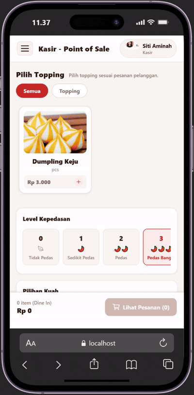

### Uji 6: Read Pesanan Aktif ###


### Uji 7: Read Riwayat Transaksi ###

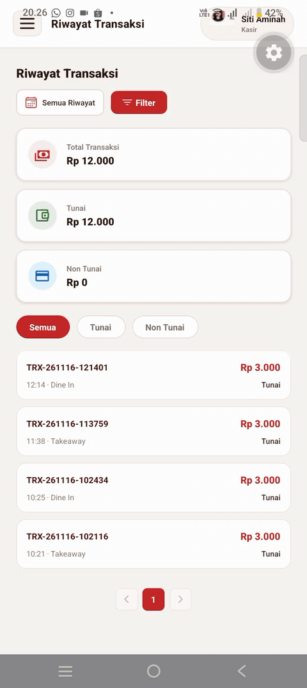

### Uji 8: Create Kasir ###


### Uji 9: Update Kasir ###


### Uji 10: Delete Kasir ###


### 2.5 Tabel `pengeluaran` (Modul Pengeluaran dan Laporan Keuangan — Faija)
```sql
create table public.pengeluaran (
  id uuid primary key default gen_random_uuid(),
  tanggal date not null default current_date,
  nama_pengeluaran text not null,
  kategori text not null,
  jumlah numeric(12,2) not null default 1 check (jumlah > 0),
  harga_satuan numeric(12,2) not null check (harga_satuan >= 0),
  total numeric(12,2) generated always as (jumlah * harga_satuan) stored,
  supplier text,
  catatan text,
  -- [SESUAIKAN] nama kolom foto sesuai tabel di Supabase:
  foto_item text,
  foto_struk text,
  dibuat_oleh uuid references public.profiles(id) on delete set null,
  created_at timestamptz not null default now(),
  updated_at timestamptz not null default now()
);

alter table public.pengeluaran enable row level security;
create policy pengeluaran_owner_all on public.pengeluaran for all to authenticated
  using (public.is_owner()) with check (public.is_owner());
```

### 2.6 Storage Bucket `pengeluaran` (Faija)
- Bucket **publik** bernama `pengeluaran` dengan batas ukuran file 5 MB dan tipe file `image/jpeg`, `image/png`, `image/webp`.
- Struktur folder: `foto_item/` untuk foto barang yang dibeli dan `foto_struk/` untuk foto struk belanja.
- Terdapat 4 *policy* pada bucket untuk mengatur akses unggah, baca, ubah, dan hapus file.

---

## 3. Implementasi Kode Program Berdasarkan Pembagian Tugas

### 3.1 Klien Supabase Terpusat & Autentikasi (Tim)
- **`src/lib/supabase.js`**: Menginisialisasi klien Supabase dengan `createClient` yang digunakan bersama oleh seluruh *service* di `src/services/`.
- **`src/services/Authservice.js`**: `signIn`, `signOut`, dan `getCurrentSession` memakai Supabase Auth. Username diubah menjadi email dengan domain `kedaiseblak.com`, dan layar yang tampil disesuaikan dengan peran (Owner atau Kasir).

### 3.2 Modul 1: Dashboard Owner — *Dewi Ikrimah*
- **`src/screens/owner/DashboardOwner.js`**: Integrasi Supabase untuk mengambil data transaksi dari tabel `transaksi`, data stok bahan baku dari tabel `stok_bahan`, dan data pengeluaran dari tabel `pengeluaran`, kemudian menampilkan ringkasan informasi pada halaman Dashboard Owner.
- **Komponen Dashboard Owner**: Menampilkan ringkasan informasi berdasarkan data aktual dari database Supabase serta memperbarui tampilan setelah data berhasil dimuat.

### 3.3 Modul 2: Manajemen Penjualan — *Dewi Ikrimah*
- **Komponen Tab Penjualan** (`src/components/owner/tabs/TabPenjualan.js`): Integrasi Supabase untuk mengambil data transaksi dari tabel `transaksi` dan rincian penjualan dari tabel `detail_transaksi`.
- **Tampilan Data Penjualan**: Menampilkan informasi nomor transaksi, nama kasir, menu yang dipesan, jumlah pesanan, subtotal, diskon, total pembayaran, dan metode pembayaran berdasarkan data yang tersimpan di Supabase.

### 3.4 Modul 3: Manajemen Stok Bahan Baku — *Dewi Ikrimah*
- **`src/components/owner/tabs/TabStok.js`**: Integrasi Supabase untuk mengambil dan menampilkan data bahan baku dari tabel `stok_bahan`, termasuk nama bahan, kategori, satuan, jumlah stok, dan batas minimum stok.
- **Penambahan Jumlah Stok (Terima Stok)**: Fitur Terima Stok pada `TabStok.js` dijalankan melalui `src/screens/owner/DashboardOwner.js` dengan `updateStock` dan `recordStockMutation` pada `src/services/stokService.js`, sehingga jumlah stok di tabel `stok_bahan` bertambah dan perubahannya tercatat sebagai mutasi stok.
- **Tampilan Riwayat Stok**: Integrasi Supabase untuk mengambil data riwayat perubahan stok dari tabel `mutasi_stok` serta informasi pembelian bahan baku dari tabel `pengeluaran`, kemudian menampilkannya pada halaman Manajemen Stok.

### 3.5 Modul 4: Menu Kasir & Manajemen Kasir Owner — *Shinta Agustina*
- **`src/screens/kasir/DashboardKasirScreen.js`**: Integrasi Supabase untuk mengambil dan menampilkan data menu dari tabel `menu_topping` pada halaman Kasir (melalui `getMenus` di `src/services/menuService.js`).
- **`src/screens/owner/KelolaKasirScreen.js`**: Integrasi Supabase untuk mengambil dan menampilkan data kasir dari tabel `kasir`, serta menambah, mengubah, dan menghapus data kasir pada halaman Manajemen Kasir Owner.
- **`src/services/kasirService.js`**: `getCashiers`, `createCashierAccount`, `updateCashier`, dan `deleteCashier` untuk mengelola tabel `kasir` dan akun Supabase Auth, dipanggil melalui `src/context/KasirContext.js`.

### 3.6 Modul 5: Transaksi Kasir, Riwayat Transaksi, Status Pesanan & Laporan Penjualan — *Maya Trisnawati*
- **`src/screens/kasir/DashboardKasirScreen.js` & `src/services/transaksiService.js` (`createTransaction`)**: Integrasi Supabase untuk menyimpan data transaksi penjualan ke tabel `transaksi` dan rincian menu yang dipesan ke tabel `detail_transaksi` setelah pembayaran selesai.
- **`src/screens/kasir/RiwayatTransaksiScreen.js`**: Integrasi Supabase untuk mengambil dan menampilkan riwayat transaksi berdasarkan data pada tabel `transaksi` dan `detail_transaksi` (melalui `getTransactions`).
- **`src/screens/kasir/PesananAktifScreen.js`**: Perubahan status pesanan melalui `updateTransactionStatus` pada `src/services/transaksiService.js`, sehingga status tersimpan di tabel `transaksi`.
- **`src/screens/kasir/LaporanPenjualanScreen.js`**: Mengolah data transaksi penjualan dari tabel `transaksi`, kemudian menampilkan rekapitulasi penjualan Kedai Seblak.

### 3.7 Modul 6: Manajemen Pengeluaran & Laporan Keuangan — *Faija Kulla Azmina*
- **`src/screens/owner/PengeluaranScreen.js`**: Integrasi Supabase untuk menyimpan, mengambil, memperbarui, dan menghapus data pengeluaran dari tabel `pengeluaran`, termasuk informasi nama pengeluaran, kategori, jumlah, harga satuan, total pembayaran, supplier, serta foto item dan foto struk. Fungsi yang dipakai berada di `src/services/pengeluaranService.js` (`getExpenses`, `createExpense`, `updateExpense`, `deleteExpense`).
- **Upload foto ke Supabase Storage**: Foto item dan foto struk diunggah ke bucket `pengeluaran` (folder `foto_item` dan `foto_struk`) dan ditampilkan melalui URL publik.
- **`src/screens/owner/LaporanKeuanganScreen.js`**: Integrasi Supabase untuk mengambil dan mengolah data pemasukan dari tabel `transaksi` serta data pengeluaran dari tabel `pengeluaran`, kemudian menampilkan ringkasan omzet, total pengeluaran, dan laba bersih berdasarkan periode harian, bulanan, dan tahunan.
- **Integrasi Pengeluaran dengan Stok**: Menghubungkan pencatatan pengeluaran pembelian bahan baku dengan data stok pada tabel `stok_bahan` serta riwayat perubahan stok pada tabel `mutasi_stok`, sehingga pencatatan pembelian dapat terhubung dengan pengelolaan persediaan bahan baku.

---

## 4. Checklist Uji Integrasi Aplikasi Kedai Seblak

**Keterangan status:** kosong = belum diuji · Lulus · Gagal

| No. | Fitur yang Diuji | PJ | Status | Hasil Pengujian |
|-----|------------------|----|--------|-----------------|
| 1 | Koneksi Aplikasi ke Supabase | Tim |  | Aplikasi berhasil terhubung ke Supabase dan data dapat dibaca tanpa error. |
| 2 | Tampilan Ringkasan Dashboard Owner | Dewi |  | Ringkasan transaksi, stok, dan pengeluaran tampil sesuai data pada tabel `transaksi`, `stok_bahan`, dan `pengeluaran`. |
| 3 | Tampilan Data Penjualan | Dewi |  | Data penjualan tampil sesuai isi tabel `transaksi` dan `detail_transaksi`. |
| 4 | Tampilan Data Stok Bahan Baku | Dewi |  | Daftar bahan baku tampil sesuai isi tabel `stok_bahan`. |
| 5 | Penambahan Jumlah Stok | Dewi |  | Jumlah stok berhasil bertambah sesuai jumlah yang diterima. |
| 6 | Tampilan Riwayat Stok dan Pembelian | Dewi |  | Riwayat perubahan stok dan pembelian tampil sesuai data pada tabel `mutasi_stok` dan `pengeluaran`. |
| 7 | Tampilan Menu pada Halaman Kasir | Shinta |  | Daftar menu tampil sesuai isi tabel `menu_topping`. |
| 8 | Tampilan Data Kasir | Shinta |  | Daftar kasir tampil sesuai isi tabel `kasir`. |
| 9 | Penambahan Data Kasir | Shinta |  | Data kasir baru berhasil ditambahkan dan tersimpan di tabel `kasir`. |
| 10 | Perubahan Data Kasir | Shinta |  | Perubahan data kasir berhasil ditampilkan dan tersimpan di tabel `kasir`. |
| 11 | Penghapusan Data Kasir | Shinta |  | Data kasir berhasil dihapus dari daftar dan tabel `kasir`. |
| 12 | Penyimpanan Data Transaksi | Maya |  | Data transaksi tersimpan di tabel `transaksi` dan rincian menu tersimpan di tabel `detail_transaksi` setelah pembayaran. |
| 13 | Tampilan Riwayat Transaksi | Maya |  | Riwayat transaksi tampil sesuai data pada tabel `transaksi` dan `detail_transaksi`. |
| 14 | Perubahan Status Pesanan | Maya |  | Status transaksi berhasil diperbarui dan tetap tersimpan setelah aplikasi dibuka kembali. |
| 15 | Tampilan Rekap Laporan Penjualan | Maya |  | Rekap penjualan tampil sesuai data transaksi yang tercatat. |
| 16 | Tampilan Daftar Pengeluaran | Faija |  | Daftar pengeluaran tampil sesuai isi tabel `pengeluaran`. |
| 17 | Penambahan Data Pengeluaran dan Foto | Faija |  | Data pengeluaran berhasil disimpan ke tabel `pengeluaran`, sedangkan foto item dan foto struk tersimpan di Storage dan dapat ditampilkan melalui URL. |
| 18 | Perubahan Data Pengeluaran | Faija |  | Perubahan data pengeluaran berhasil ditampilkan dan tersimpan di tabel `pengeluaran`. |
| 19 | Penghapusan Data Pengeluaran | Faija |  | Data pengeluaran berhasil dihapus dari daftar dan tabel `pengeluaran`. |
| 20 | Tampilan dan Pembaruan Laporan Keuangan | Faija |  | Omzet, total pengeluaran, dan laba bersih tampil serta diperbarui setelah terdapat transaksi dan pengeluaran baru. |
| 21 | Integrasi Pengeluaran dengan Penerimaan Stok | Faija |  | Pengeluaran pembelian bahan baku yang telah dicatat tampil pada daftar Terima Stok. |
| 22 | Pencatatan Perubahan Stok | Faija |  | Perubahan jumlah stok berhasil tercatat di tabel `mutasi_stok` setelah stok diterima melalui fitur Terima Stok. |
| 23 | Persistensi Data Cloud | Tim |  | Data seluruh modul tetap utuh setelah aplikasi ditutup dan dibuka kembali, karena tersimpan di Supabase dan bukan di memori lokal. |
| 24 | Pembatasan Akses (Row Level Security) | Tim |  | Akses data dibatasi sesuai peran: data yang hanya untuk owner (seperti pengeluaran, stok, dan kasir) tidak dapat diakses oleh akun kasir atau pengguna tanpa login. |

---

## 5. Dokumentasi Bukti Pengerjaan (Screenshot & GIF)

> **Petunjuk Anggota Tim:**
> Simpan file screenshot / GIF ke folder proyek, lalu pastikan nama file sesuai dengan atribut `src="..."` pada setiap bagian di bawah ini.

---

### Bagian A: Bukti Modul Menu Kasir & Manajemen Kasir (*Shinta*)

#### A.1 Bukti Koneksi Konsol Expo & Supabase
<div align="center">
  
</div>

#### A.2 Tabel `menu_topping` di Table Editor Supabase
<div align="center">
  
</div>
</div>

#### A.3 Tampilan Menu pada Halaman Kasir
<div align="center">
  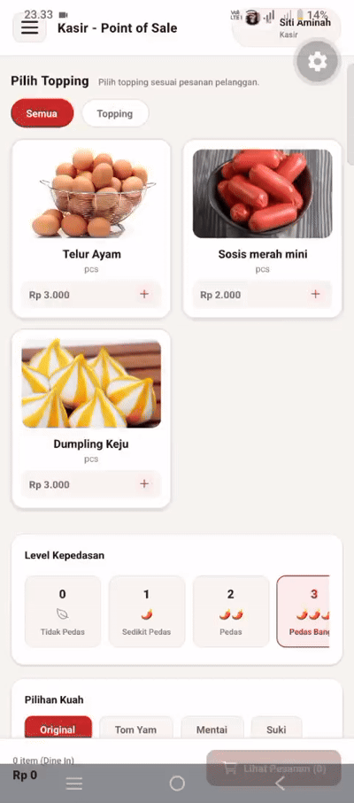
</div>

#### A.4 Tabel `kasir` di Table Editor Supabase
<div align="center">
  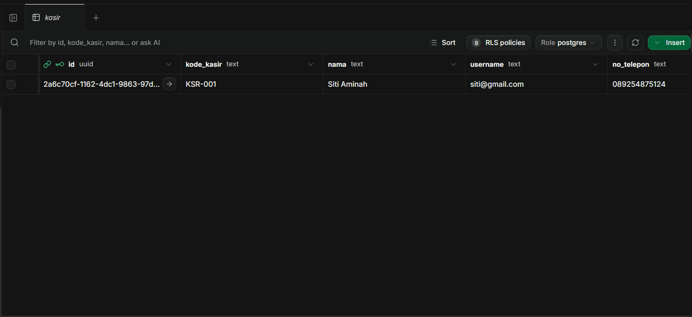
</div>

#### A.5 Tampilan Data Kasir pada Manajemen Kasir Owner
<div align="center">
  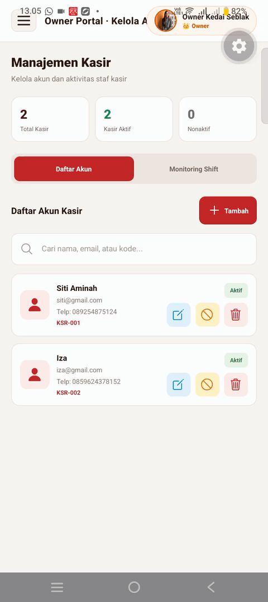
</div>

#### A.6 Tambah, Ubah, dan Hapus Data Kasir
<div align="center">
  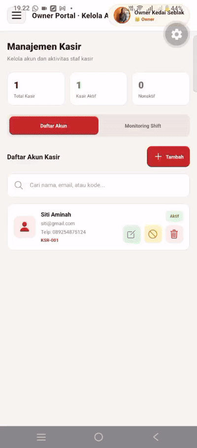
</div>

---

### Bagian B: Bukti Modul Transaksi, Riwayat & Laporan Penjualan (*Maya*)

#### B.1 Tabel `transaksi` & `detail_transaksi` di Supabase
<div align="center">
  )" width="75%" alt="Tabel Transaksi Supabase"

</div>

#### B.2 Penyimpanan Transaksi Setelah Pembayaran
<div align="center">
  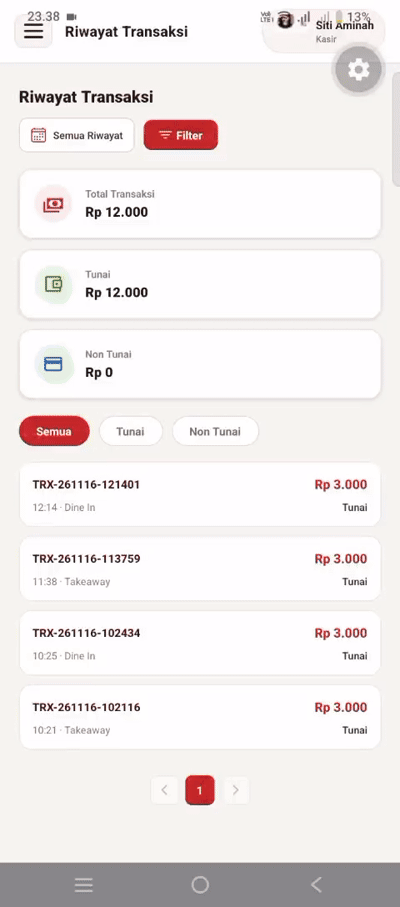
</div>

#### B.3 Tampilan Riwayat Transaksi & Detail Transaksi
<div align="center">
  
</div>

#### B.4 Perubahan Status Pesanan
<div align="center">
  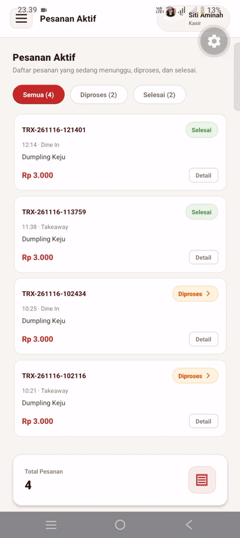
</div>

#### B.5 Rekap Laporan Penjualan
<div align="center">
  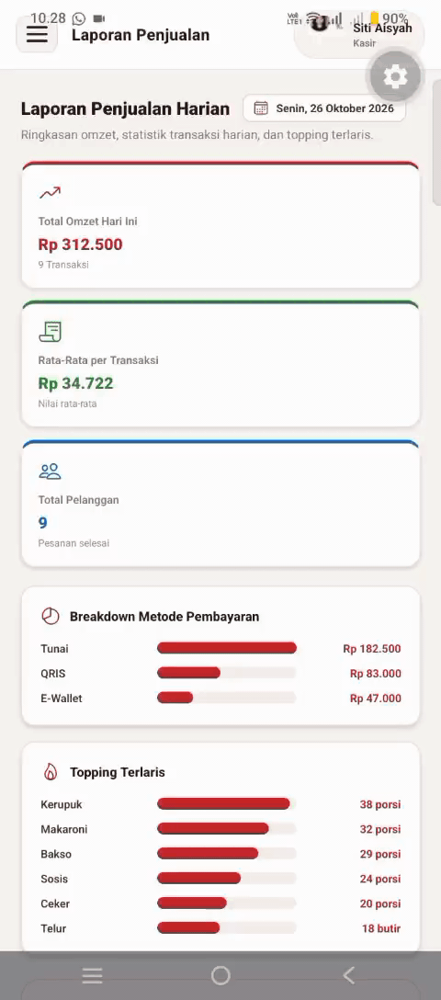
</div>

---

### Bagian C: Bukti Modul Dashboard Owner & Manajemen Stok (*Dewi*)

#### C.1 Tabel `stok_bahan` & `mutasi_stok` di Supabase
<div align="center">
  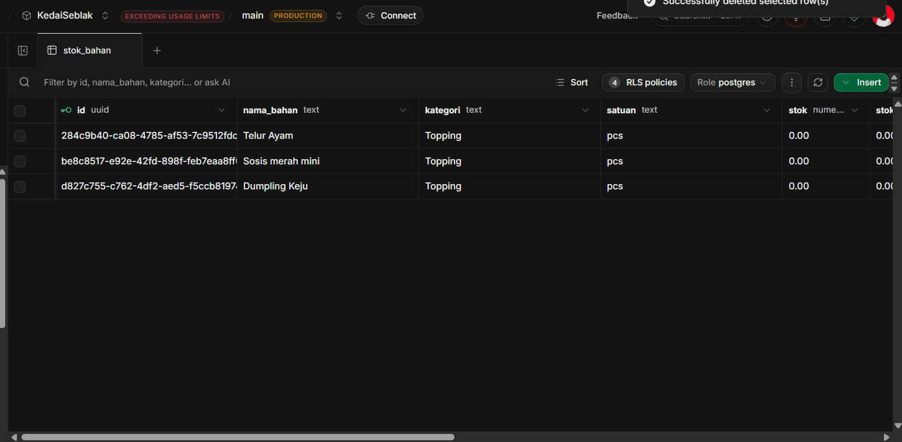
  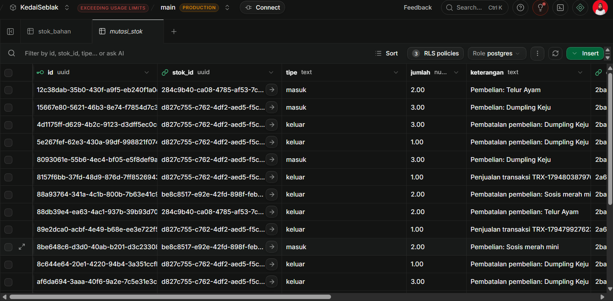
</div>

#### C.2 Dashboard Owner (Ringkasan dari Data Cloud)
<div align="center">
  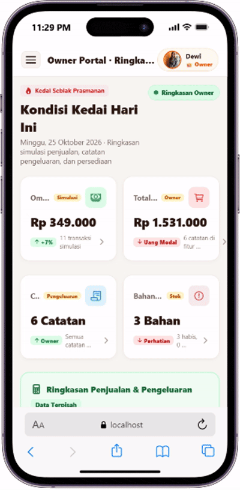
</div>

#### C.3 Tampilan Data Penjualan
<div align="center">
  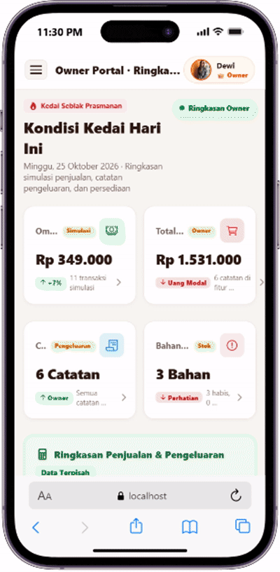
</div>

#### C.4 Tampilan Data Stok Bahan Baku
<div align="center">
  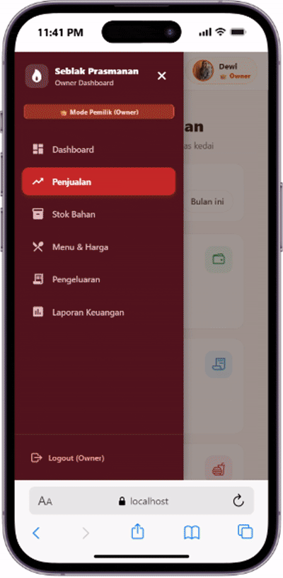
</div>

#### C.5 Penambahan Jumlah Stok & Riwayat Stok
<div align="center">
  
</div>

---

### Bagian D: Bukti Modul Pengeluaran & Laporan Keuangan (*Faija*)

#### D.1 Tabel `pengeluaran` di Supabase (Kolom Foto Item & Foto Struk)
<div align="center">
  
</div>

#### D.2 Cloud Storage Bucket `pengeluaran`
<div align="center">
  
</div>

#### D.3 Isi Bucket `pengeluaran` (Folder `foto_item` dan `foto_struk`)
<div align="center">
  
</div>

#### D.4 Tambah, Ubah, dan Hapus Pengeluaran dengan Foto
<div align="center">
  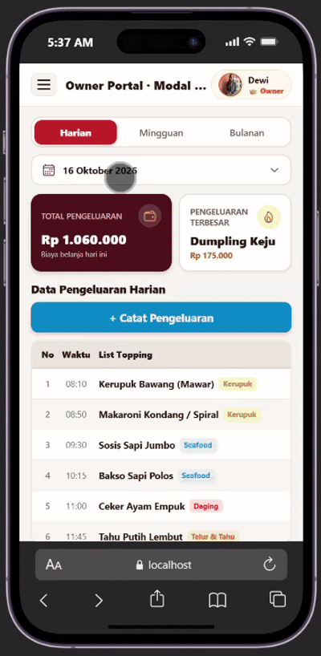
</div>

#### D.5 Laporan Keuangan Owner (Omzet, Pengeluaran, Laba Bersih)
<div align="center">
  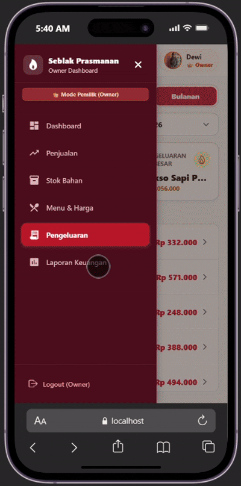
</div>

#### D.6 Integrasi Pengeluaran dengan Terima Stok & Pencatatan `mutasi_stok`
<div align="center">
  
</div>

---

### Bagian E: Bukti Persistensi Data Cloud & Pembatasan Akses RLS (*Tim*)

#### E.1 Data Tetap Utuh Setelah Aplikasi Ditutup dan Dibuka Kembali
<div align="center">
  
</div>

#### E.2 Row Level Security Aktif dan Daftar Policy di Supabase
<div align="center">
  
</div>

#### E.3 Pembatasan Akses Berdasarkan Peran (Kasir Tidak Dapat Mengakses Data Owner)
<div align="center">
  
</div>

---

## 6. Kesimpulan

Praktikum Pertemuan 9 telah berhasil memigrasikan sistem penyimpanan data aplikasi **Kedai Seblak** dari data dummy lokal (`mockData`) ke layanan backend cloud **Supabase** (PostgreSQL Database, Supabase Auth, dan Cloud Storage) melalui klien terpusat `src/lib/supabase.js` dan lapisan *service* per entitas.

Kolaborasi tim Kelompok 3 berhasil membagi tanggung jawab ke dalam 6 modul utama:
1. **Dashboard Owner:** Dikerjakan oleh **Dewi Ikrimah**, mencakup ringkasan transaksi, stok, dan pengeluaran dari data Supabase.
2. **Manajemen Penjualan:** Dikerjakan oleh **Dewi Ikrimah**, mencakup tampilan data penjualan dari tabel `transaksi` dan `detail_transaksi`.
3. **Manajemen Stok Bahan Baku:** Dikerjakan oleh **Dewi Ikrimah**, mencakup data `stok_bahan`, penambahan jumlah stok, serta riwayat `mutasi_stok` dan pembelian.
4. **Menu Kasir & Manajemen Kasir Owner:** Dikerjakan oleh **Shinta Agustina**, mencakup tampilan menu dari tabel `menu_topping` pada halaman kasir dan CRUD data kasir pada tabel `kasir`.
5. **Transaksi Kasir, Riwayat Transaksi, Status Pesanan & Laporan Penjualan:** Dikerjakan oleh **Maya Trisnawati**, mencakup penyimpanan transaksi ke tabel `transaksi` dan `detail_transaksi`, riwayat transaksi, perubahan status pesanan, serta rekap laporan penjualan.
6. **Manajemen Pengeluaran & Laporan Keuangan:** Dikerjakan oleh **Faija Kulla Azmina**, mencakup CRUD `pengeluaran` dengan foto item dan foto struk di Supabase Storage (bucket `pengeluaran`, folder `foto_item` dan `foto_struk`), laporan keuangan owner, serta integrasi pengeluaran dengan stok.

Seluruh tabel dilindungi *Row Level Security* (RLS) berbasis peran (owner dan kasir), sehingga hak akses data sesuai tanggung jawab masing-masing pengguna. Data tetap utuh setelah aplikasi ditutup dan dibuka ulang, dan foto pengeluaran diakses lewat URL publik Supabase Storage. Dengan integrasi ini, aplikasi Kedai Seblak memiliki penyimpanan data yang permanen, aman, dan sinkron antara layar kasir dan owner.
