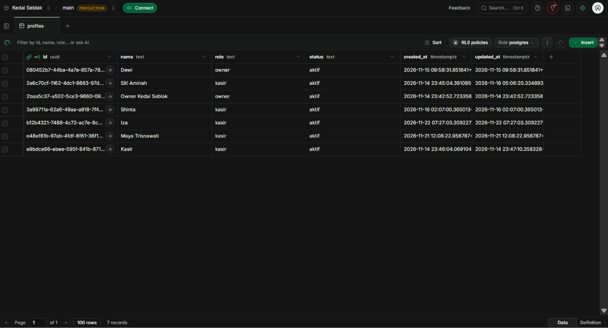
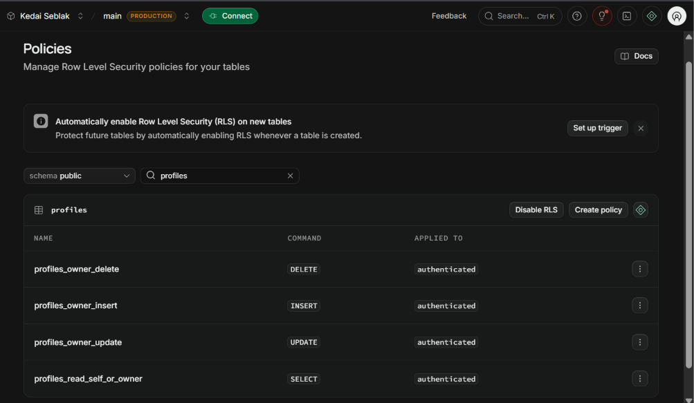

# Laporan Pengembangan — Pemrograman Mobile I
## Login OAuth Google & Manajemen Kasir
### Studi Kasus: Sistem Manajemen Kedai Seblak

### Identitas Proyek & Praktikum

- **Mata Kuliah:** Pemrograman Mobile 
- **Pertemuan:** 10 — OAuth, Login & Register
- **Dosen Pengampu:** Mohamad Firdaus, M.Kom
- **Tanggal Praktikum:** November 2026
- **Kelas / Kelompok:** Kelas 5B / Kelompok 3
- **Repository:** https://github.com/Shinta-Agustina/Seblak-Project-Kelompok3

Anggota kelompok dan pembagian tugas: [isi nama anggota dan pekerjaan masing-masing]

1. Tujuan dan Capaian

Sistem login pada aplikasi Kedai Seblak sebelumnya menggunakan kredensial demo yang ditulis langsung dalam kode, belum memiliki persistensi sesi, dan belum memanfaatkan profil basis data sebagai dasar pengaturan hak akses. Praktikum ini mengembangkan autentikasi dengan Supabase Auth, menyediakan login email-password serta Google OAuth, dan menghubungkan profil pengguna dengan peran owner atau kasir.

Mengganti kredensial login hardcode dengan autentikasi Supabase.

Menyediakan login menggunakan email-password dan Google OAuth melalui Expo Auth Proxy.

Menyimpan profil pengguna pada tabel profiles yang terhubung dengan auth.users.

Menerapkan RLS untuk mengatur akses profil pengguna dan pengelolaan kasir oleh owner.

Mengatur navigasi berdasarkan peran owner dan kasir.

Memungkinkan owner mendaftarkan, mengubah, dan menghapus akun kasir.

Mempertahankan sesi login, melakukan pemeriksaan status akun, dan menyediakan logout.

2. Skenario dan Alur Login

2.1 Skenario Penggunaan

Owner pertama disiapkan melalui dashboard Supabase dan profilnya dimasukkan ke tabel profiles.

Owner masuk ke aplikasi, lalu mengelola pendaftaran akun kasir melalui layar Kelola Kasir.

Kasir menggunakan email dan password yang telah didaftarkan serta diverifikasi, atau masuk menggunakan Google sesuai implementasi modul.

Aplikasi memeriksa autentikasi dan memuat profil dari tabel profiles.

Status akun diperiksa. Kasir Nonaktif ditolak saat login.

Peran pada profil digunakan untuk menentukan dashboard dan navigasi yang ditampilkan.

Logout mengakhiri sesi Supabase dan pengguna kembali ke layar login.

2.2 Diagram Alur

Alur umum autentikasi:

Aplikasi dibuka → pemeriksaan sesi → (jika belum login) layar Login → email/password atau Google OAuth → Supabase memvalidasi → profil dimuat dari profiles → validasi status dan peran → dashboard owner/kasir. Jika validasi gagal, pengguna kembali ke login.

2.3 Langkah Rinci

A. Setup akun owner pertama

Project Supabase disiapkan dan tabel profiles beserta kebijakan RLS dibuat.

Owner pertama dibuat pada Authentication → Users melalui dashboard Supabase.

UID, email, nama, peran owner, dan status Aktif dimasukkan ke tabel profiles.

Confirm email tetap aktif sesuai keputusan desain modul.

B. Login email dan password

Pengguna mengisi email dan password pada layar login.

AuthContext memanggil Supabase Auth untuk memvalidasi kredensial.

Jika autentikasi berhasil, aplikasi memuat profil berdasarkan UID pengguna.

Profil yang tidak ditemukan atau status kasir Nonaktif ditolak dan sesi dibersihkan.

Profil valid diteruskan ke navigasi berdasarkan peran.

C. Login Google melalui Expo Proxy

Pengguna memilih tombol Google pada layar login.

Aplikasi memulai OAuth melalui Supabase dan menggunakan alamat proxy Expo auth.expo.io.

Browser membuka halaman Google untuk pemilihan akun.

Setelah otorisasi, proses callback/proxy mengembalikan kode ke aplikasi atau browser sesuai platform.

Supabase menukar kode menjadi sesi; AuthContext memuat profil.

Status dan peran diperiksa sebelum pengguna diarahkan ke dashboard.

D. Pengelolaan kasir

Owner membuka Kelola Kasir.

Owner mendaftarkan akun melalui form, mengisi data yang diwajibkan, dan menentukan peran jika tersedia.

Proses pendaftaran Auth dan penambahan profil dilakukan mengikuti fungsi yang disediakan AuthContext.

Owner dapat mengubah informasi/status kasir atau menghapus akun sesuai hak akses.

Kasir berstatus Nonaktif ditolak saat login.

E. Logout dan pemulihan sesi

Aplikasi memulihkan sesi ketika dibuka kembali melalui Supabase Auth. Logout memanggil signOut sehingga sesi dihapus dan pengguna kembali ke layar login. Profil yang dimuat pada AuthContext menjadi dasar tampilan dan navigasi.

3. Arsitektur Basis Data & Keamanan (Supabase)

3.1 Skema Tabel profiles

Tabel public.profiles menghubungkan data profil dengan akun Supabase Auth. Pada modul, kolom utama meliputi id (UUID yang merujuk auth.users), email, nama, peran, phone, status, dan created_at. Peran disimpan dengan huruf kecil (owner/kasir), sedangkan status memakai nilai Aktif atau Nonaktif.

3.2 Row Level Security

RLS diaktifkan pada tabel profiles. Policy baris sendiri mengatur akses pengguna terhadap profil miliknya. Policy owner digunakan untuk memberikan kewenangan administrasi profil kasir kepada owner. Fungsi public.is_owner() digunakan dalam policy untuk mengidentifikasi owner.

Policy yang diterapkan dalam modul mencakup akses baca/tambah/ubah baris sendiri dan akses owner untuk membaca, menambah, mengubah, serta menghapus profil pengguna lain. Penerapan policy perlu diuji menggunakan akun owner dan akun non-owner.

3.3 Pengamanan pendaftaran dan status

Tidak terdapat register publik. Pendaftaran kasir dilakukan oleh owner melalui fitur Kelola Kasir. Confirm email tetap aktif agar proses signUp kasir tidak mengambil alih sesi owner yang sedang mendaftarkan akun. Status Nonaktif diperiksa ketika pengguna mencoba login.

4. Setup Supabase, Aplikasi & Google OAuth

4.1 Supabase Dashboard

Buat atau pilih project Supabase yang digunakan kelompok.

Buat tabel profiles yang terhubung dengan auth.users, dengan kolom profil, peran, dan status.

Aktifkan RLS dan buat policy pengguna serta owner sesuai modul.

Buat akun owner pertama melalui Authentication → Users dan tambahkan profil owner melalui SQL.

Pastikan Confirm email aktif pada konfigurasi provider Email.

4.2 Konfigurasi aplikasi dan dependensi

Konfigurasi app.json diperbarui untuk slug kedai-seblak, scheme kedaiseblak, serta package Android. Dependensi Supabase Auth, SecureStore, Auth Session, dan URL polyfill dipasang mengikuti modul. File .env digunakan untuk Project URL dan anon key, dan harus diabaikan oleh Git.

4.3 Klien Supabase

Klien Supabase dibuat pada src/lib/supabase.js. Native menggunakan SecureStore untuk persistensi sesi, sementara web menggunakan localStorage. Konfigurasi mencakup persistSession, autoRefreshToken, dan flowType PKCE. detectSessionInUrl disesuaikan untuk web.

4.4 Google Cloud Console dan provider Supabase

Buat OAuth Client ID bertipe Web application pada Google Cloud Console.

Daftarkan callback Supabase sebagai Authorized redirect URI di Google Cloud.

Salin Client ID dan Client Secret ke provider Google di dashboard Supabase.

Aktifkan provider Google.

Daftarkan redirect URL proxy Expo https://auth.expo.io/@anonymous/kedai-seblak, scheme kedaiseblak, dan URL localhost untuk pengujian web sesuai modul.

Jangan menyimpan Client Secret pada source code atau repository.

4.5 Login Google di Expo Go

Modul menggunakan layanan Expo Auth Proxy secara manual melalui auth.expo.io untuk mendukung pengujian di Expo Go. Proxy ini bersifat deprecated dan bergantung pada layanan serta cookie browser. Jika tidak dapat digunakan, modul menyediakan opsi pengembangan menggunakan development build.

5. Implementasi Kode Program Berdasarkan Pembagian Tugas

5.1 Kontrak dan komponen utama

AuthContext menjadi pusat proses autentikasi, profil, login, logout, pendaftaran, pemuatan, pembaruan, dan penghapusan akun kasir. Komponen layar dan navigasi mengakses data autentikasi melalui context agar tidak mengulang proses login dan pemuatan profil.

5.2 Modul 1: Setup Supabase dan RLS

Membuat tabel profiles dan hubungan UID dengan auth.users.

Membuat fungsi is_owner() untuk pemeriksaan peran owner.

Membuat policy RLS untuk pengguna dan owner.

Menyiapkan owner pertama dan memastikan Confirm email aktif.

Memeriksa akses policy menggunakan akun sesuai peran.

5.3 Modul 2: AuthContext dan Supabase Client

Membuat klien Supabase dan konfigurasi penyimpanan sesi sesuai platform.

Membuat AuthProvider dan fungsi pemuatan profil.

Menerapkan login email-password serta penanganan error dan email belum terkonfirmasi.

Menerapkan login Google melalui proxy Expo dan pertukaran kode/sesi.

Memeriksa status akun kasir Nonaktif dan melakukan signOut apabila akses ditolak.

Menerapkan logout dan pemulihan sesi.

5.4 Modul 3: LoginScreen dan AppNavigator

LoginScreen menyediakan input email/password, validasi, pesan error, serta tombol Google.

Akun demo hardcode dihapus.

AppNavigator memuat profil dan menentukan akses owner atau kasir.

Layar loading ditampilkan ketika pemulihan sesi berlangsung.

Navigasi menolak pengguna tanpa profil yang sesuai atau kasir Nonaktif.

5.5 Modul 4: Kelola Kasir dan integrasi profil

Owner dapat melihat daftar profil kasir.

Form pendaftaran kasir memvalidasi data yang diperlukan.

Fungsi pembaruan digunakan untuk mengubah data/status kasir.

Fungsi penghapusan menghapus akun/profil sesuai implementasi.

TopHeader menggunakan nama dan peran dari profil, bukan data hardcode.

Sidebar menyediakan logout melalui Supabase.

KasirContext mempertahankan logika bisnis yang tidak menjadi fokus autentikasi.

5.6 Pengujian dan dokumentasi

Pengujian dilakukan terhadap login email-password, login Google, pendaftaran kasir oleh owner, status kasir Nonaktif, navigasi berdasarkan peran, persistensi sesi, logout, dan validasi keamanan input. Bukti hasil pengujian dilampirkan setelah proses pengujian.

6. Dokumentasi Bukti Pengerjaan

Masukkan screenshot atau GIF sesuai bukti yang berhasil direkam. Bagian ini mengikuti gaya laporan contoh dan dapat disusun per fitur.

6.1 Setup Supabase, tabel profiles, dan RLS — [tempel bukti]

a. Tabel Profiles

b. RLS

6.2 Login email-password — [tempel bukti]

a. Login Kasir 

.gif>)

b. Login Owner 

.gif>)

6.3 Login Google melalui Expo Go — [tempel bukti]

a. Login Kasir 

b. Login Owner 

6.4 Dashboard owner dan kasir 

6.5 Owner mendaftarkan kasir 

6.6 Pengujian status kasir Nonaktif dan logout

a. Nonaktifkan akun kasir 

b. Login kasir sudah nonaktif 

7. Catatan dan Keterbatasan

Login Google melalui proxy Expo bergantung pada layanan auth.expo.io yang deprecated; development build merupakan alternatif bila proxy tidak tersedia.

Pengguna Google yang belum pernah didaftarkan owner dapat otomatis dibuat sebagai kasir sesuai perilaku praktikum; untuk penggunaan produksi perlu pembatasan allowlist.

Confirm email harus tetap aktif agar sesi owner tidak tertukar ketika mendaftarkan kasir.

Data bisnis seperti keranjang, checkout, menu, transaksi, dan stok belum menjadi cakupan autentikasi pada modul ini dan masih menggunakan mock/in-memory data sesuai catatan modul.

Foto profil masih mengikuti implementasi yang tersedia dan belum menjadi fitur unggah Storage jika belum dikembangkan.

Tab Monitoring Shift pada KelolaKasirScreen masih menggunakan data dummy menurut catatan modul.

Status hasil pengujian aktual dan bukti perlu dilengkapi sebelum laporan dikumpulkan.

8. Kesimpulan

Pengembangan praktikum mengintegrasikan Supabase Auth untuk login email-password dan Google OAuth, memuat profil dari tabel profiles, menerapkan peran owner/kasir, serta menyediakan pengelolaan akun kasir oleh owner. RLS digunakan untuk membatasi akses profil, sesi autentikasi dipertahankan, dan navigasi ditentukan oleh profil pengguna. Kesimpulan capaian akhir harus disesuaikan dengan hasil pengujian aktual yang dilaksanakan.

Pembagian tugas kelompok: [tuliskan anggota dan tanggung jawab masing-masing, mengikuti urutan pengerjaan dan kontribusi aktual].