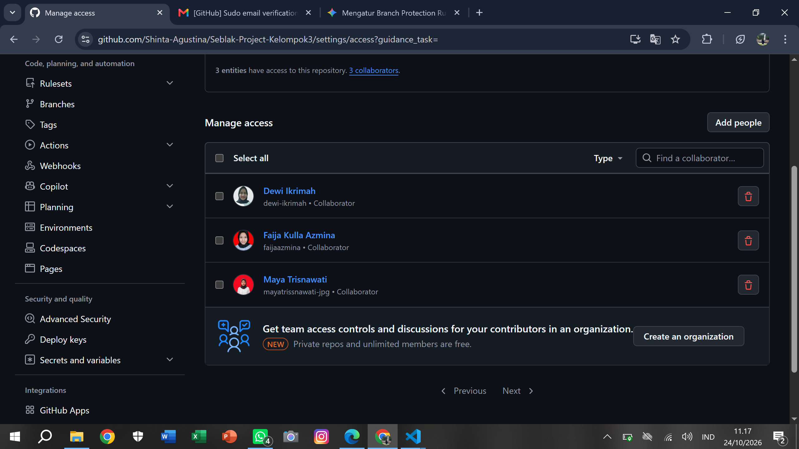
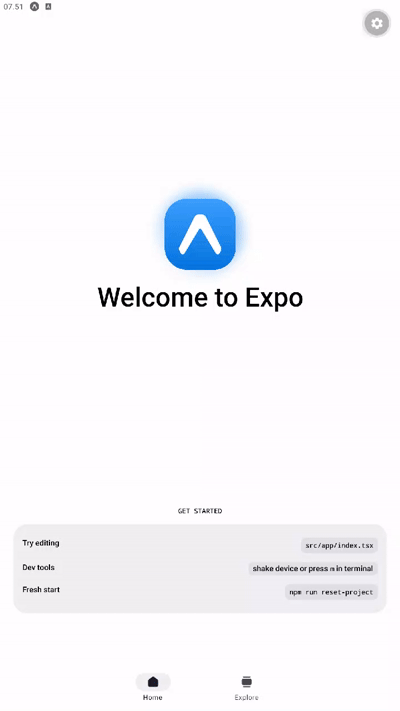
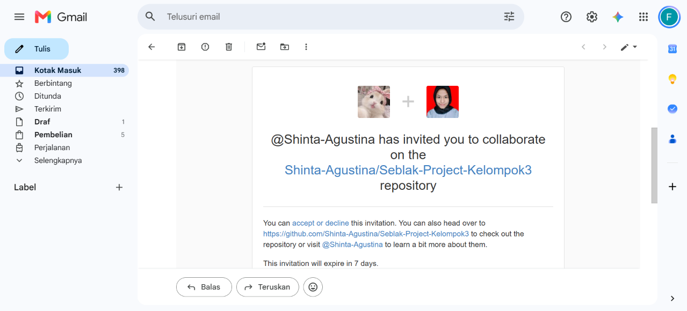

# Laporan Progress Kelompok 3 #
## Anggota Kelompok ##
1. Shinta Agustina
2. Faija Kulla Azmina
3. Dewi Ikrimah
4. Maya Trisnawati

### Progress 1 : Pertemuan 5 ###
1. Pm membuat repository dan invite member
2. konfirmasi bukti

3. Pm membuat inisiasi Project
4. Konfirmasi bukti

Tugas Member :
1. Accept invite
2. Bukti Konfirmasi
Faija

Maya

Dewi 

3. Clone project
4. Bukti konfirmasi
Faija

Maya

Dewi

Tugas Bersama :
1. Diskusi penentuan tema (Notulen  bersama)
Opsi Pertama dan Terakhir adalah Manajemen Kedai Seblak
