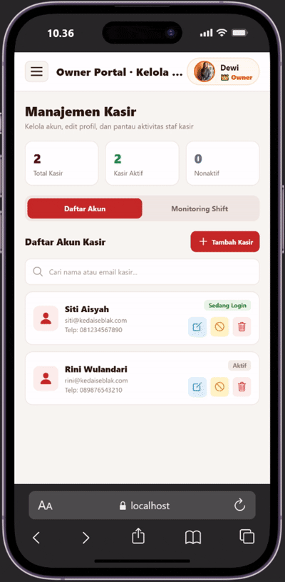

# LAPORAN PROGRESS PERBAIKAN

### 1. Menyatukan form login untuk Kasir dan Owner

### 2. Mengganti pilih nomor meja menjadi (Dine in/Takeaway)

### 3. Menambahkan Manajemen Kasir

### 4. Inputan stok nominal harga manual (diganti dengan sistem pengeluaran yang langsung terhubung ke stok)

### 5. Stok hanya melihat apa yang perlu di stok

